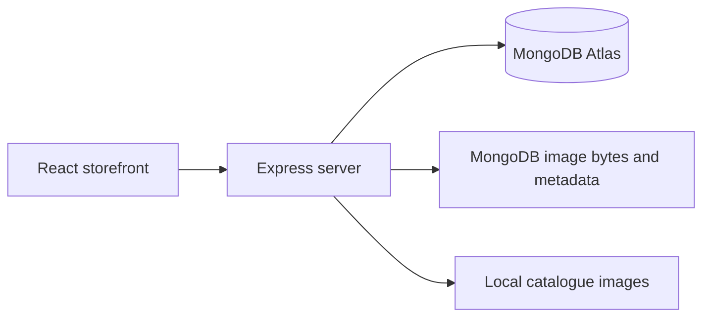

# FORME — Wear your own rhythm

A clothing shopping application built with **MongoDB, Express, React and Node.js**. FORME brings together a public storefront, secure customer accounts, size-based inventory, an administrator studio and a community for outfit voting.

Built for a college demonstration, the project includes **44 sample clothing products**, local product images, prices in Indian Rupees and a complete cash-on-delivery order flow.

## Contents

- [Features](#features)
- [Technology and architecture](#technology-and-architecture)
- [Getting started](#getting-started)
- [Administrator access](#administrator-access)
- [Available commands](#available-commands)
- [Project structure](#project-structure)
- [Pages and API](#pages-and-api)
- [Database and catalogue](#database-and-catalogue)
- [Security and privacy](#security-and-privacy)
- [Testing](#testing)
- [Production](#production)
- [Troubleshooting](#troubleshooting)
- [Scope and image sources](#scope-and-image-sources)

## Features

### Shopping

- Browse and search by category, collection and price.
- View product photos, descriptions, fabric information and care instructions.
- Choose XS, S, M, L or XL, with stock managed separately for each size.
- Save favourites and keep a shopping bag on the current device.
- Get suggestions for complementary, in-stock pieces based on the bag.
- Apply coupons and receive a server-calculated checkout total.
- Place cash-on-delivery orders, track fulfilment and cancel eligible orders.

Shipping costs **₹99**, with free delivery on orders of **₹1,999 or more**. No payment gateway is connected.

### Fit, reviews and community

- **Size recommendations:** enter height, weight, waist and shoulder measurements, with optional chest/bust and hip. The app explains its general chart estimate and checks stock separately. Measurements are not saved. See [sizing rules and limitations](docs/SIZING.md).
- **Product reviews:** add a rating, text and up to three photos; update or delete your own review. Delivered purchases are verified by the server before receiving a badge.
- **Outfit face-offs:** publish one to three looks for members to vote on. Each member has one changeable vote; voting closes after seven days. Members cannot vote on their own post.
- **Compressed photos:** uploaded images are resized, stripped of metadata and saved as WebP, with a maximum of 250 KB per image.

### Dashboards

| Customer account | Administrator studio |
| --- | --- |
| Order and activity overview | Collected earnings and order statistics |
| Profile and password editing | Product creation, editing and archival |
| Active session controls | Inventory for every size |
| Own reviews and outfit posts | Customer and order management |
| Account deletion | Coupons and content moderation |

## Technology and architecture

| Layer | Technology |
| --- | --- |
| Interface | React 19, TypeScript, React Router |
| Styling and interaction | Tailwind CSS 4, custom CSS, Motion, Lucide icons |
| Development and build | Vite 8, tsx |
| Backend | Node.js 22+, Express 4 |
| Database | MongoDB Atlas with Mongoose |
| Authentication | JWT cookies and salted scrypt password hashes |
| Validation and images | express-validator, Sharp |
| Verification | Node.js test runner and live API checks |



Local development uses one Express process with Vite middleware on port 3000. Standalone production serves dist; Vercel hosts the Express API beside Vite static output. See [Vercel deployment and Neon Google login](docs/DEPLOYMENT.md).

## Getting started

### 1. Prerequisites

Install **Node.js 22.x (22.14 or newer)**, npm and Git. Create a MongoDB Atlas cluster and a database user with read/write access to **`shopDB`**.

Atlas gives the replica-set support required by order transactions. A local MongoDB alternative must also be configured as a replica set; a standalone database does not support these transactions.

### 2. Clone and install

```bash
git clone https://github.com/Satyamcoder-2006/mern-shopping_store-webtechlab.git
cd mern-shopping_store-webtechlab
npm ci
```

Run all subsequent commands from this project root. There are no separate frontend/backend installations.

### 3. Configure the environment

Copy the placeholder configuration to a private `.env` file.

**Windows PowerShell:**

```powershell
Copy-Item .env.example .env
```

**macOS/Linux:**

```bash
cp .env.example .env
```

Edit the following values:

| Variable | Purpose |
| --- | --- |
| `MONGO_URI` | Atlas connection string with your own credentials |
| `JWT_SECRET` | Random secret of at least 32 characters |
| `PORT` | Preferred HTTP port; normally `3000` |
| `ADMIN_EMAIL` | Account to provision with administrator access |
| `COOKIE_SECURE` | `false` for local HTTP; `true` for HTTPS hosting |

Generate a JWT secret and paste the output into `.env`:

```bash
node -e "console.log(require('node:crypto').randomBytes(48).toString('hex'))"
```

In Atlas, add your current public IP under **Security → Network Access** and wait until the entry is active. URL-encode special characters in database passwords when constructing the URI.

The application uses **`MONGO_DB_NAME`**, defaulting to **`shopDB`**. Real credentials belong only in `.env`, which is excluded from Git; `.env.example` contains placeholders.

### 4. Start development

```bash
npm run dev
```

Open the URL printed in the terminal, normally **http://localhost:3000**. If that port is occupied, the server tries the next available port.

The backend restarts when its files change, while Vite handles frontend updates. On the first successful database connection, migrations install the demo catalogue once. Register your own customer account through Sign up; no shared demo login is provided.

## Administrator access

Set `ADMIN_EMAIL` in `.env` to the address you want to use, then run:

```bash
npm run admin:setup
```

- An existing account is promoted and keeps its current password.
- Otherwise, the script creates an administrator and saves a generated password in the private **`.admin-credentials.txt`** file.

Log in through the storefront and open **`/admin`**. Change a generated password from **Account → Account security**. Public registration always creates a customer; admin credentials are never embedded in React.

Content moderation is available at **`/admin/community`**. Both the pages and backend routes enforce the administrator role.

## Available commands

| Command | Purpose |
| --- | --- |
| `npm run dev` | Development server with backend/frontend reload |
| `npm run build` | Build the frontend into `dist/` |
| `npm start` | Start the complete production server; build first |
| `npm run lint` | TypeScript checks |
| `npm test` | Unit tests without Atlas credentials |
| `npm run test:atlas` | Live API/database verification against the existing port-3000 server |
| `npm run db:check` | Credential-safe Atlas diagnostics |
| `npm run admin:setup` | Provision the configured administrator |
| `npm run catalog:expand` | Apply the repeatable campus catalogue expansion |
| `npm run audit:files` | Check Git-visible files for private paths, local secrets and oversized files |
| `npm run clean` | Remove generated build and coverage output |

`npm run preview` is Vite's frontend-only preview. Use **`npm start`** to test the production frontend and API together.

## Project structure

```text
.
├── .github/workflows/       # Repository, type, test and build checks
├── backend/
│   ├── app.ts              # Express routes and middleware
│   ├── models.ts           # Mongoose schemas and indexes
│   ├── database.ts         # Connection, initialization and migrations
│   ├── commerce.ts         # Checkout, stock, coupons and fulfilment
│   ├── community.ts        # Reviews, outfit voting, media and sessions
│   ├── security.ts         # JWT cookies, authorization, CSRF and limits
│   ├── validation.ts       # Express validation and injection guards
│   ├── media.ts            # Image compression, storage and cleanup
│   ├── privacy.ts          # Account erasure and order anonymization
│   └── campus-catalog.ts   # Additional sample products
├── docs/                   # Feature notes, sizing research, image sources
├── public/catalog/         # Compressed images shipped with the app
├── scripts/                # Setup, diagnostics and maintenance commands
├── shared/                 # Password, sizing and outfit logic
├── src/
│   ├── store/              # Pages, dashboards, API client and cart state
│   ├── styles/             # Storefront, responsive and community styles
│   └── utils/              # Shared utility code
├── .env.example            # Configuration template without credentials
├── package-lock.json       # Reproducible npm dependency versions
├── server.ts               # Application entry point
└── vite.config.ts          # Frontend build and development settings
```

Dependencies, build output, runtime uploads, credentials and local reports are intentionally excluded from version control.

## Pages and API

### Application pages

| Path | Page |
| --- | --- |
| `/` | Landing page |
| `/shop` | Clothing catalogue |
| `/product/:id` | Product, stock, size guidance and reviews |
| `/community` | Outfit voting feed |
| `/checkout` | Authenticated checkout |
| `/account` | Customer dashboard, profile, orders and sessions |
| `/admin` | Administrator studio |
| `/admin/community` | Content moderation |

### Main API groups

| Endpoint | Purpose |
| --- | --- |
| `POST /api/users` | Register a customer |
| `POST /api/login`, `POST /api/logout` | Sign in and sign out |
| `GET /api/session` | Current account and CSRF token |
| `GET`, `PUT`, `PATCH`, `DELETE /api/users/me` | Owner-only account management |
| `/api/users/me/sessions` | List and revoke sessions |
| `GET /api/products` | Public catalogue |
| `POST /api/size-recommendation` | Validated size guidance |
| `/api/products/:productId/reviews` | Review list and own-review operations |
| `/api/faceoffs` | Outfit posts and voting |
| `POST /api/media` | Authenticated photo upload |
| `POST /api/checkout/quote` | Server-calculated order quote |
| `/api/orders` | Owner-only orders and cancellation |
| `/api/admin/*` | Administrator-only management |
| `GET /api/health` | Store/database readiness |

Protected operations use the session cookie. Authenticated mutations also require the session-bound **`X-CSRF-Token`** header; the frontend API client handles this automatically. Route files contain the exact request fields.

## Database and catalogue

The main collections are `users`, `products`, `orders`, `coupons`, `reviews`, `faceoffs`, `votes` and `media`. Registration and login use the same users collection.

The **44 illustrative products** comprise eight original entries and 36 campus additions. Every entry has INR pricing, descriptions, care information, local images and size-specific inventory. Women's apparel focuses on regular tops, full-length bottoms and covered layers.

Initialization is tracked in the `migrations` collection:

1. The initial clothing migration adds missing demo product IDs with insert-only updates; existing products and stock are preserved.
2. The campus migration adds new product IDs and corrects the original demo imagery.

Migrations run once. Restarts do not refill stock, duplicate products or recreate products archived by an administrator. Use a dedicated project database when first setting up the application.

Orders use transactions for stock reservations, coupon redemption and cancellation. Price snapshots preserve historical totals. Idempotency keys prevent duplicate orders when checkout is retried.

## Security and privacy

- **Passwords:** salted scrypt hashes; sensitive actions require the current password.
- **Sessions:** signed JWTs in HttpOnly, SameSite cookies; eight-hour expiry and a maximum of three active sessions. A fourth login revokes the oldest session.
- **Authorization:** protected operations check the current database user, role and resource ownership.
- **Validation:** express-validator, typed field allowlists, rejected Mongo operator/prototype keys, origin checks and session-bound CSRF tokens.
- **Request limits:** overall API limits, authentication brute-force limits and additional upload/post/vote limits. Pricing and stock are always checked by the server.
- **Photos:** metadata-free WebP image bytes (up to 250 KB each) live in MongoDB media documents with a unique media ID, owner reference, attachment reference, content type and timestamps. Only published attachments are publicly served. Unused uploads expire after an hour.
- **Account deletion:** removes the profile, sessions and community data, cancels eligible pending orders, and removes identity/email/address from retained financial snapshots. In-transit orders must be resolved first.

MongoDB backups include user-uploaded images. On startup, legacy `uploads/community/` images are migrated without changing IDs or URLs; each local file is removed only after the stored database bytes are verified. New uploads never write image files to disk.

Rate limits are per Node process. Multiple server instances require a shared limiter and correctly configured trusted reverse proxies.

## Testing

Run the local checks:

```bash
npm run audit:files
npm run lint
npm test
npm run build
```

To run the API suite against the configured development database:

```bash
npm run test:atlas
```

The live suite creates uniquely named disposable users, products, orders, coupons, posts, reviews and photos, then cleans them up. It does not leave a shared demo customer behind.

`npm run test:media` checks MongoDB image storage against the existing server on port 3000. It verifies published image bytes and ownership, private drafts, upload atomicity, transaction rollback, deletion and the absence of local image files. Its disposable account and uploads are removed afterward.

GitHub Actions runs the repository audit, type checks, unit tests and production build on pushes and pull requests. It needs no Atlas credentials; live database tests remain a separate command.

## Production

For a single Vercel deployment, see [docs/DEPLOYMENT.md](docs/DEPLOYMENT.md) for exact settings, environment variables, database setup, Google login and verification.

```bash
npm ci
npm run build
npm start
```

`npm start` explicitly enables production mode and serves the complete application. Configure `.env` on the host, enable HTTPS, set `COOKIE_SECURE=true` for HTTPS cookies and back up MongoDB, including its media collection.

## Troubleshooting

| Symptom | What to check |
| --- | --- |
| Atlas cannot connect or rejects TLS | Run `npm run db:check`; verify credentials, cluster availability and an active Network Access IP entry |
| Store loads but database actions return 503 | Wait for readiness and inspect the server's credential-safe connection message |
| Port 3000 is occupied | Use the next printed URL, stop an older instance or change `PORT` |
| Frontend changes appear but API changes do not | Use `npm run dev` or restart an older manually started process |
| Production build is missing | Run `npm run build` before `npm start` |
| A fresh clone has no administrator | Set `ADMIN_EMAIL` and run `npm run admin:setup` |
| Uploaded images are missing | Restore the MongoDB media collection; for legacy installations, include existing local uploads on the first startup so they can migrate |
| A session stops working | It may have expired, been revoked or been replaced after another login |

TLS certificate verification stays enabled. Unavailable database connections are retried every 15 seconds while the storefront remains accessible.

## Scope and image sources

Product specifications, pricing and stock are **demo data**. Reviews and outfit posts are user-created; fabricated community content is not seeded. Size suggestions are general estimates, not guaranteed physical fit predictions. Google authentication is planned separately and is not implemented.

A public launch also requires account recovery/email verification, monitoring, backups and appropriate payment/fulfilment integrations. Current checkout supports cash on delivery only.

Images are bundled locally for a dependable demonstration. Source URLs and provider attribution are listed in [the image-source manifest](docs/CATALOG_IMAGE_SOURCES.json). Third-party photos retain their respective rights; the project does not claim ownership of them.

Further documentation:

- [Feature and security status](docs/FEATURE_STATUS.md)
- [Sizing research and assumptions](docs/SIZING.md)
- [Verification notes](VERIFICATION.md)
